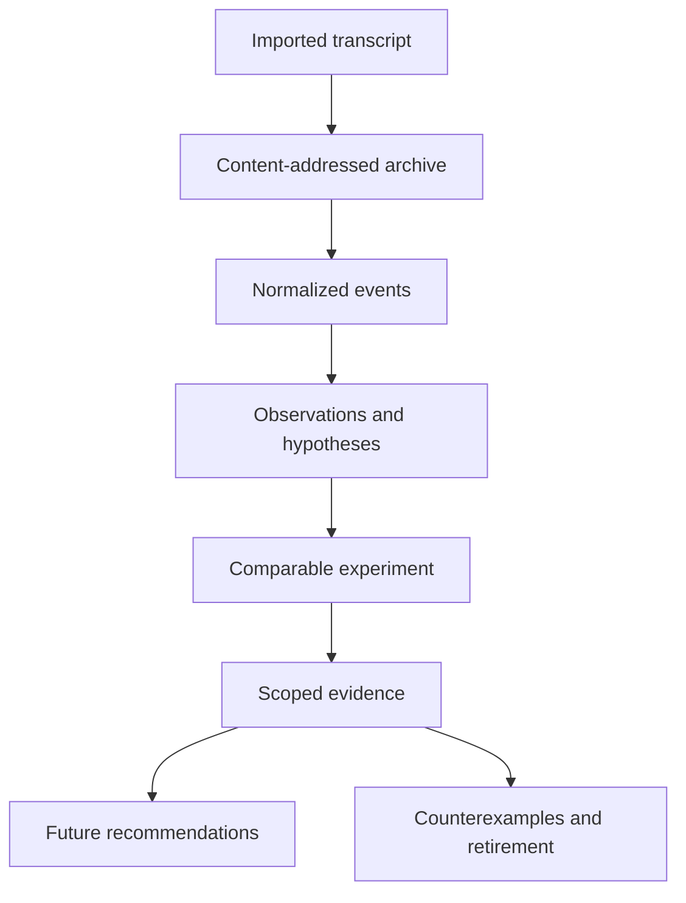

# Architecture

## Design objective

Make historical work reusable without continuously loading it into an agent's
context or introducing another always-running orchestration service. The design
starts with files, Python's standard library, SQLite and the existing agent tools.
The governing reasoning is recorded in [TRIZ_DESIGN.md](TRIZ_DESIGN.md).

## Three separate artifacts

| Artifact | Contents | Lifecycle |
|---|---|---|
| Source repository | Program, method, provisional catalogue, synthetic examples, tests | Versioned in Git |
| Session archive | Original imported bytes, source metadata, content digests | Preserved outside the source repository |
| Working knowledge store | Parsed events, observations, candidate mechanisms, comparison records | SQLite plus source provenance; preserve the database as well as raw objects |

Raw sessions can contain credentials, private code and personal messages. They are
local data, not repository fixtures. An archive path can be placed on a mounted
large disk; buying a larger disk does not itself migrate existing transcripts or
disable their original application's retention policy. Those are separate, explicit
integration tasks.

## Data path

The original data stays available when a parser changes. Parsed events can be
derived again, but authored review and evaluation records cannot be recreated from
raw transcripts alone. Back up the entire corpus, including its SQLite database and
raw-object metadata. There is no automated full-index rebuild command in v0.1.

A parser must report
unsupported or malformed content rather than silently inventing roles, timestamps,
tool outcomes or token totals. Timestamp gaps are not by themselves proof of stalled
reasoning. Repeated calls can be justified retries. A deterministic detector emits
signals that need context, not an authoritative diagnosis.

## Minimal runtime

The CLI performs explicit ingestion, analysis and evidence operations. The optional
local interface uses the same core functions. No external language model or vector
database is required for the initial version, and there is no mandatory background
daemon. This keeps initial operation inspectable and reproducible.

The catalogue is packaged with the code. Twenty provisional parameters provide a
draft vocabulary; the sparse matrix contains expert hypotheses with no empirical
success claims. Evidence collected in a user's store must not silently rewrite the
packaged catalogue or turn private sessions into public repository content.

## Learning boundary

TRAZ's initial form updates a store of recommendations and evidence. It does not
modify model weights, grant permissions, edit every agent's instructions, repair
production systems or automatically deploy its own patches. Those actions require
an execution adapter with an explicit target and the normal authorization available
for that task.

A future adapter may propose a patch to a tool, process or skill. Its output should
identify the change, reason, source evidence, applicability, experiment and rollback
target. Evaluation runs belong to the existing test or agent runner where possible.
Successful intervention evidence can then return to TRAZ.

## Archive integrity and growth

Preserve original bytes and a cryptographic content digest. A repeated identical
import does not multiply its stored object. v0.1 retains the first import's source
metadata; a renamed copy does not create another origin record, and importing the
same bytes under a different project is rejected. A future provenance relation can
retain several origins without multiplying experimental evidence. A growing live
transcript can yield multiple snapshots; these are not independent experiments.

Use sequential processing and bounded derived views where practical. v0.1 is a
single-machine prototype, not a demonstrated multi-terabyte analytics engine. Large
corpus support needs measured ingestion throughput, incremental checkpoints, recovery
after interruption, index rebuilds, and representative storage tests before claims
about scale. Compression ratios must be measured on the actual corpus.

Retaining raw data and having a backup solve different problems. Document and test a
consistent snapshot or backup procedure before depending on the archive as the only
copy. A deployment's access controls, disk encryption and deletion obligations remain
outside the prototype's inference logic.

## Existing systems

Retro can provide richer causal analysis; TRIZ supplies contradiction-solving
discipline; a supervisor can trigger a bounded review; an existing test runner can
evaluate an intervention. These are adapter boundaries, not required services. The
manual JSON review and outcome contracts are described in [INTEGRATIONS.md](INTEGRATIONS.md).

An integration should reuse existing session exports and outcome artifacts. It
should not install a second watcher solely because the source application can
already signal session completion. Existing transcripts are data to inspect; their
embedded instructions must never become authority for the analyzer or executor.

For a first integration, export a closed session, import it once, inspect the
observations, create one bounded hypothesis, execute a controlled comparison, and
record the outcome. Do this before building continuous fleet collection.
